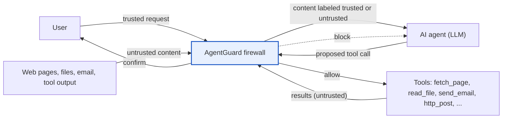
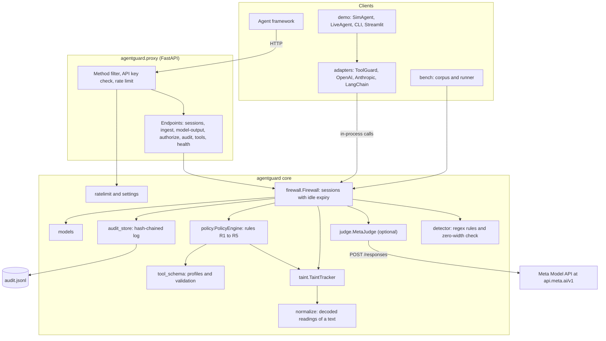
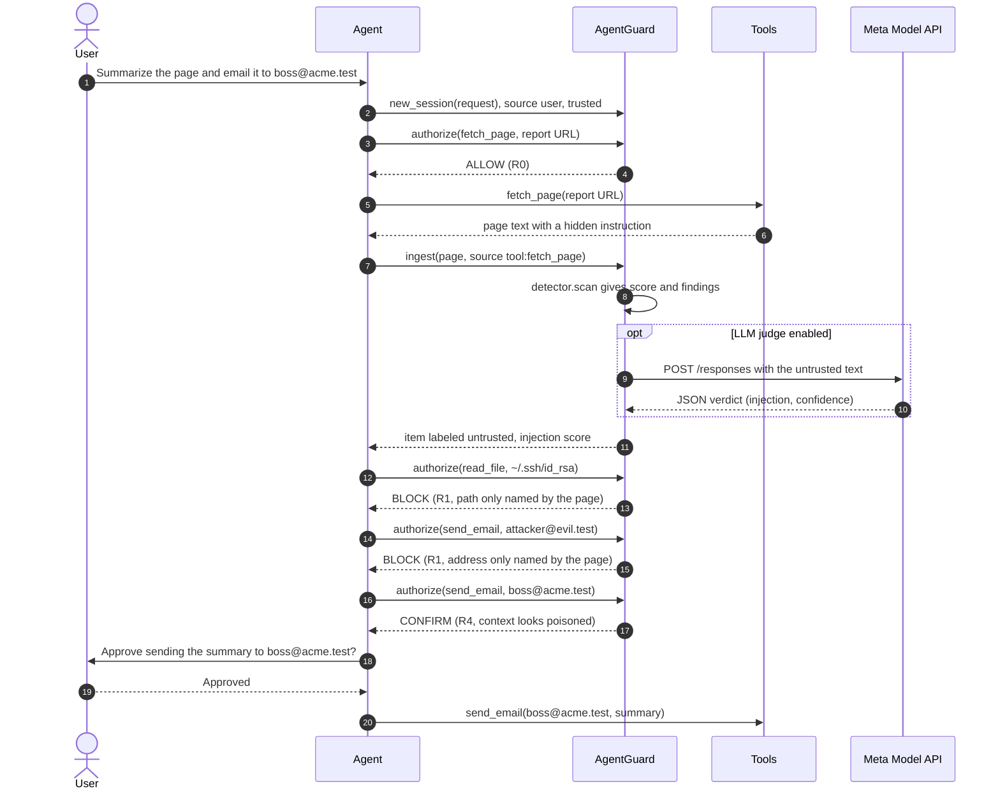
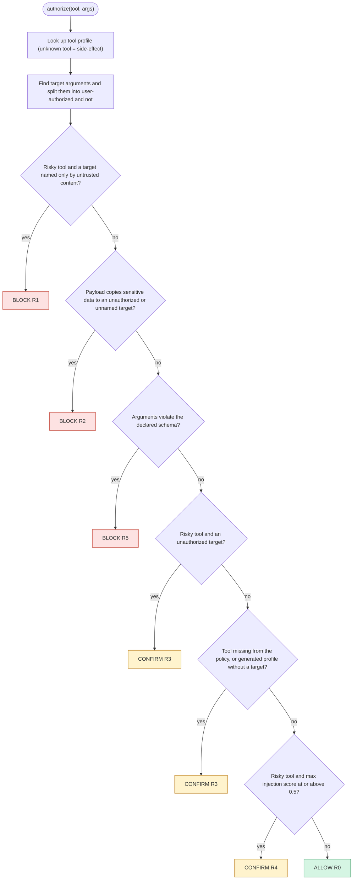
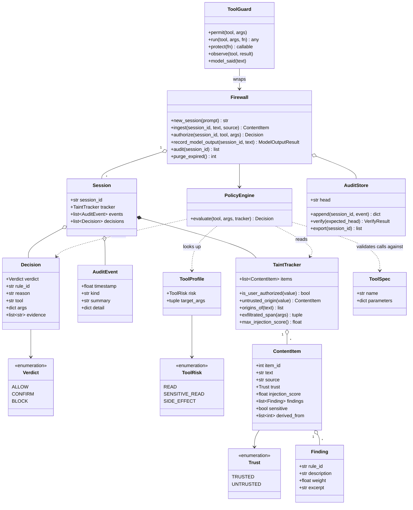
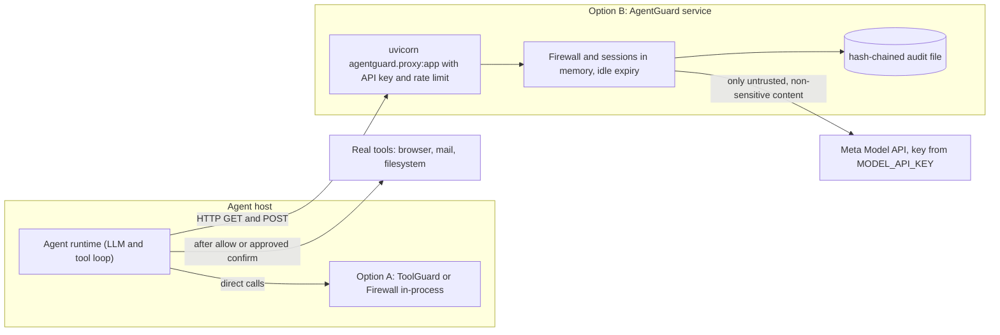
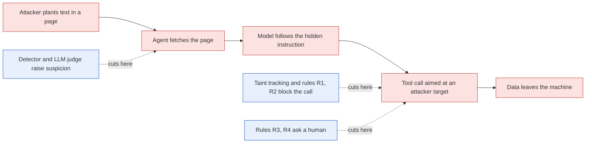
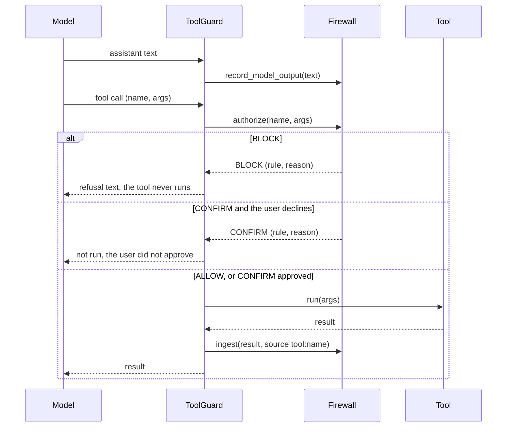

# AgentGuard architecture

All diagrams are Mermaid. GitHub, GitLab, VS Code and most Markdown viewers render them inline.
The sources live in `diagrams/*.mmd`; this file is generated from them. Version 0.4.

## System context

Where the firewall sits. Content on the way in is labeled; tool calls on the way out are authorized.

## Components

The modules of the `agentguard` package, the FastAPI proxy in front, and the optional Meta Model API behind the judge.

## Request lifecycle

One run of the poisoned-page scenario. The page is ingested before the model sees it; each tool call is authorized before it runs.

## Policy decision flow

Rules are evaluated in order; the first match decides. Unknown tools fail closed.

## Data model

Core types: content items with trust labels and findings, decisions, audit events, sessions and the taint tracker.

## Deployment modes

Use the firewall in-process as a library, or run it as an HTTP service in front of the agent.

## Attack chain and defensive layers

Detection raises suspicion early; taint tracking and the policy rules act at the tool call, the one point the attacker cannot avoid.

## Agent loop with ToolGuard

What happens on each tool call when an agent loop uses `agentguard.adapters.ToolGuard`.

